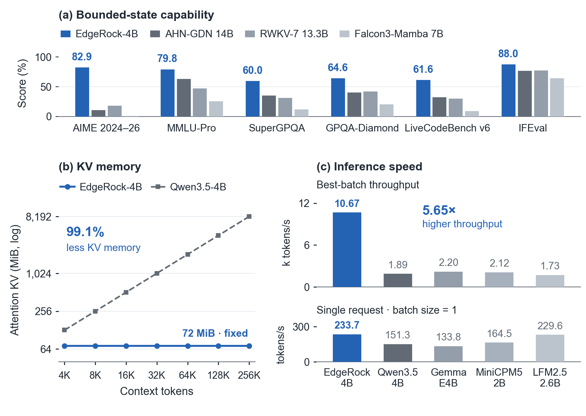
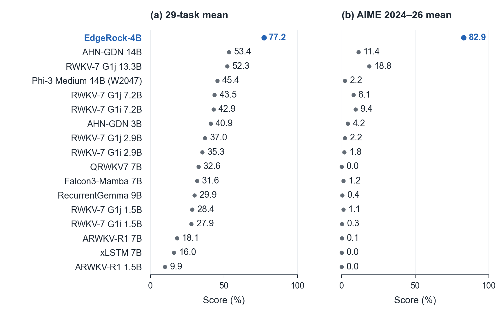
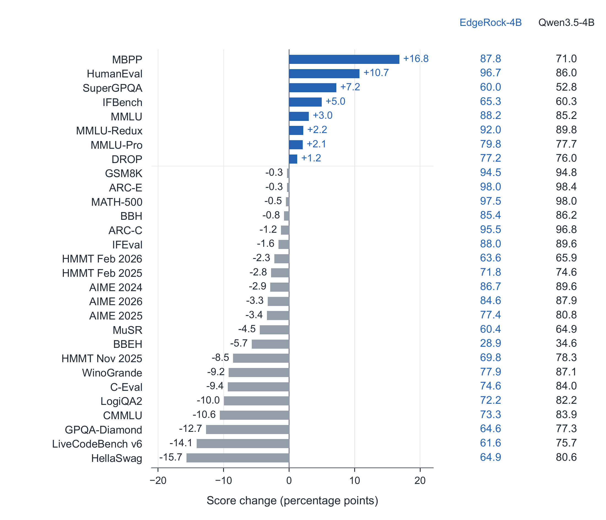
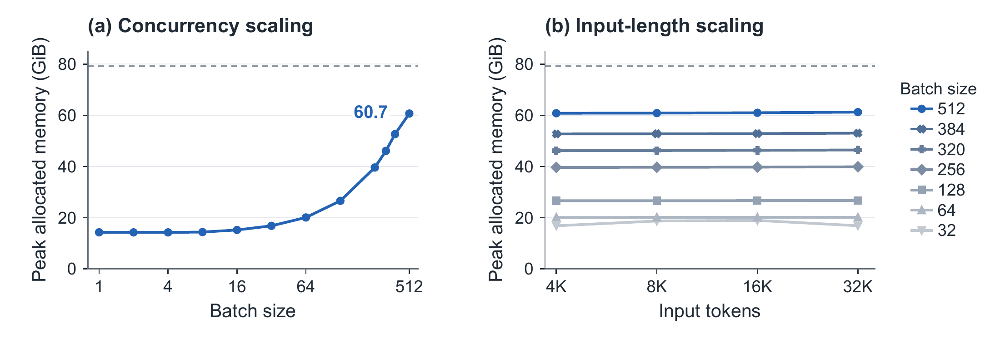
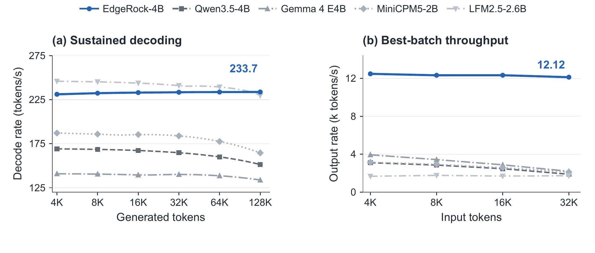
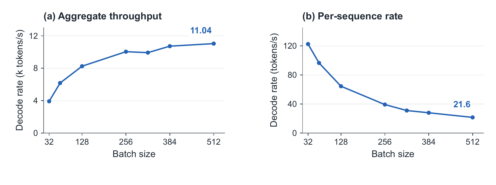
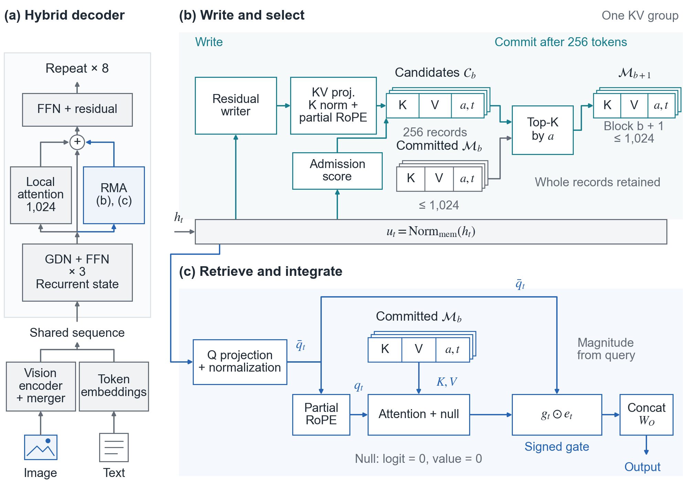
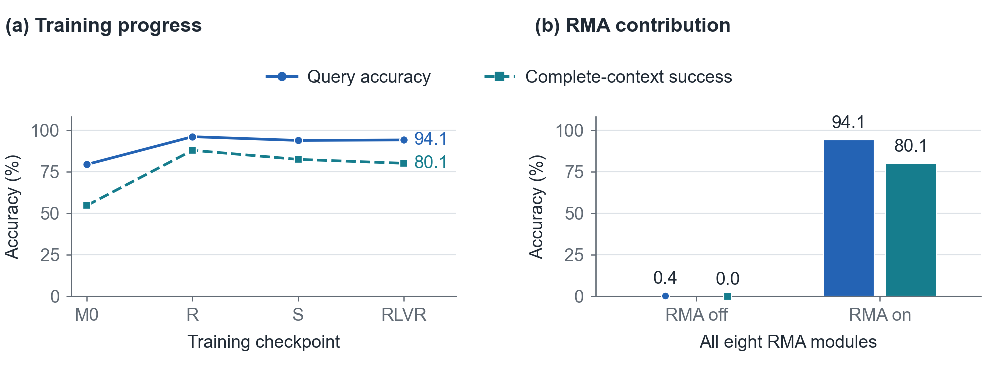

<div align="center">
  <h1> EdgeRock</h1>
  <p><strong>Strong Reasoning at Constant Memory</strong><br /><sub><a href="https://rockmatrix.ai">ROCK MATRIX · rockmatrix.ai</a></sub></p>
  <p><b>English</b> · <a href="README_zh-CN.md">简体中文</a></p>
  <p>
    <a href="docs/report/EdgeRock_Technical_Report.pdf"></a>
    <a href="https://huggingface.co/rockmatrix-ai/EdgeRock"></a>
    <a href="https://modelscope.cn/models/rockmatrix/EdgeRock"></a>
  </p>
</div>

**EdgeRock brings strong reasoning to a fixed history budget.** EdgeRock-4B, our first open-source release, supports text and image reasoning. Its constant-size history leaves more GPU memory available for sustained reasoning and concurrent serving. More model sizes are in preparation.

- **Strong mathematical reasoning:** **82.9%** mean AIME pass@1, versus 18.8% for the strongest evaluated bounded-state baseline.
- **O(1) history memory:** fixed **72 MiB** attention KV per sequence—**99.1% less** than Qwen3.5-4B.
- **Higher serving throughput:** **6.42×** Qwen3.5-4B's output throughput at each model's best measured batch.

[Quick start](#quick-start) · [Key results](#capability) · [Models](#model-directory) · [Documentation](#documentation)



*AIME is mean pass@1 across 2024–2026; KV is compared at 256K context. Serving throughput uses 32K input and 32K output on one Hopper 80GB GPU at each model's best measured batch. It counts output tokens only, with elapsed time including prefill.*

<a id="quick-start"></a>

## Quick start

| Model | Input modalities | Model weights |
| --- | --- | --- |
| **EdgeRock-4B** | Text, images | [Hugging Face](https://huggingface.co/rockmatrix-ai/EdgeRock) · [ModelScope](https://modelscope.cn/models/rockmatrix/EdgeRock) |

```bash
git clone https://github.com/rockmatrix-ai/EdgeRock.git
cd EdgeRock
python -m venv .venv
source .venv/bin/activate
python -m pip install ./wheels/transformers-5.7.0.dev0-py3-none-any.whl -e .
hf download rockmatrix-ai/EdgeRock --local-dir checkpoints/EdgeRock-4B \
  --include '*.safetensors' '*.json' '*.jinja' 'tokenizer*' 'vocab*' 'merges*' \
  --exclude 'evaluation_data/*'
cp config.json configuration_edgerock.py modeling_edgerock.py checkpoints/EdgeRock-4B/
python run.py demo --model checkpoints/EdgeRock-4B \
  --prompt 'Solve 17 × 23, explaining your reasoning.' --max-new-tokens 2048
```

For optimized inference and serving, see the [inference guide](USAGE.md).

<a id="model-directory"></a>

## Model directory

Choose a package by runtime. These links point to the existing model repositories; each card contains its installation instructions, license, and validation scope.

### Original model and compact PyTorch

| Model repository | Format / runtime |
| --- | --- |
| [EdgeRock-4B (original)](https://huggingface.co/rockmatrix-ai/EdgeRock) | BF16 · text and images |
| [EdgeRock-4B-NF4](https://huggingface.co/rockmatrix-ai/EdgeRock-4B-NF4) | NF4 · included compact loader |
| [EdgeRock-4B-INT8](https://huggingface.co/rockmatrix-ai/EdgeRock-4B-INT8) | INT8 · included compact loader |
| [EdgeRock-4B-FP8](https://huggingface.co/rockmatrix-ai/EdgeRock-4B-FP8) | FP8 · included compact loader |

The compact packages validate text inference on Hopper; see each card for its conversion checks. Original-model benchmark scores do not establish quantized-package accuracy or throughput.

### MLX

| Model repository | Format / runtime |
| --- | --- |
| [EdgeRock-4B-MLX-8bit](https://huggingface.co/hkust-aaron/EdgeRock-4B-MLX-8bit) | 8-bit · group 64 |
| [EdgeRock-4B-MLX-6bit-g64](https://huggingface.co/hkust-aaron/EdgeRock-4B-MLX-6bit-g64) | 6-bit · group 64 |
| [EdgeRock-4B-MLX-4bit-g32](https://huggingface.co/hkust-aaron/EdgeRock-4B-MLX-4bit-g32) | 4-bit · group 32 |
| [EdgeRock-4B-MLX-4bit-mixed](https://huggingface.co/hkust-aaron/EdgeRock-4B-MLX-4bit-mixed) | Mixed 4-bit |

These packages use the included EdgeRock MLX runtime. Functional checks were run on Linux CUDA; Apple Metal has not been tested.

### GGUF and ONNX

| Model repository | Format / runtime |
| --- | --- |
| [EdgeRock-4B-GGUF](https://huggingface.co/hkust-aaron/EdgeRock-4B-GGUF) | 7 profiles · custom EdgeRock backend |
| [EdgeRock-4B-ONNX-Q4-g32](https://huggingface.co/hkust-aaron/EdgeRock-4B-ONNX-Q4-g32) | 4-bit · ONNX Runtime CUDA |
| [EdgeRock-4B-ONNX-Q4-CPU-g32](https://huggingface.co/hkust-aaron/EdgeRock-4B-ONNX-Q4-CPU-g32) | 4-bit · ONNX Runtime CPU |
| [EdgeRock-4B-ONNX-Q8](https://huggingface.co/hkust-aaron/EdgeRock-4B-ONNX-Q8) | 8-bit · ONNX Runtime CUDA |

GGUF requires the custom EdgeRock RMA backend; stock llama.cpp/Ollama is not supported. Bundled native binaries target Linux x86-64 Hopper. ONNX packages require their supplied stateful runner; mobile ONNX Runtime has not been tested.

### Mobile development previews

| Model repository | Format / runtime |
| --- | --- |
| [EdgeRock-4B-LiteRT-LM-INT8](https://huggingface.co/hkust-aaron/EdgeRock-4B-LiteRT-LM-INT8) | INT8 · LiteRT-LM CPU preview |
| [EdgeRock-4B-LiteRT-LM-INT4](https://huggingface.co/hkust-aaron/EdgeRock-4B-LiteRT-LM-INT4) | INT4 · LiteRT-LM CPU preview |

Development previews for Google AI Edge Gallery. Full-model long-memory checks and Android device validation are in progress; image and audio inputs are not included.

<a id="capability"></a>

## Reasoning and multimodal capability

<a id="strong-reasoning-within-the-bounded-state-class"></a>

### Strong reasoning at constant memory

EdgeRock-4B demonstrates strong mathematical reasoning at constant memory: **82.9% mean AIME 2024–2026 pass@1**, versus 18.8% for RWKV-7 G1j in the 14B class. It leads **24 of 29 text benchmarks**, with a 77.2% mean versus 53.4% for AHN-GDN Qwen2.5 14B.

<details>
<summary>All 17 bounded-state models</summary>



**Bounded-state models.** W2047 denotes Phi-3 Medium's configured 2,047-token attention window.

| Model | 29-benchmark mean | AIME mean | MATH-500 | MMLU-Pro | LiveCodeBench v6 | IFEval |
| --- | ---: | ---: | ---: | ---: | ---: | ---: |
| **EdgeRock-4B** | **77.2** | **82.9** | **97.5** | **79.8** | **61.6** | **88.0** |
| AHN-GDN Qwen2.5 14B | 53.4 | 11.4 | 80.0 | 63.5 | 32.9 | 77.4 |
| RWKV-7 G1j 13.3B | 52.3 | 18.8 | 77.2 | 47.6 | 30.7 | 77.8 |
| Phi-3 Medium 4K Instruct (W2047) | 45.4 | 2.2 | 49.0 | 54.0 | 19.1 | 61.4 |
| RWKV-7 G1j 7.2B | 43.5 | 8.1 | 64.2 | 46.2 | 21.3 | 66.5 |
| RWKV-7 G1i 7.2B | 42.9 | 9.4 | 68.6 | 44.9 | 18.8 | 53.4 |
| AHN-GDN Qwen2.5 3B | 40.9 | 4.2 | 66.2 | 42.8 | 14.6 | 58.6 |
| RWKV-7 G1j 2.9B | 37.0 | 2.2 | 48.2 | 37.9 | 12.1 | 56.4 |
| RWKV-7 G1i 2.9B | 35.3 | 1.8 | 43.8 | 37.8 | 11.6 | 43.1 |
| QRWKV7 7B Instruct | 32.6 | 0.0 | 41.0 | 23.0 | 12.4 | 59.0 |
| Falcon3-Mamba 7B Instruct | 31.6 | 1.2 | 41.8 | 26.1 | 9.3 | 64.7 |
| RecurrentGemma 9B IT | 29.9 | 0.4 | 22.8 | 13.4 | 7.9 | 39.7 |
| RWKV-7 G1j 1.5B | 28.4 | 1.1 | 31.4 | 16.6 | 6.3 | 46.2 |
| RWKV-7 G1i 1.5B | 27.9 | 0.3 | 28.2 | 13.3 | 7.2 | 37.0 |
| ARWKV-R1 7B | 18.1 | 0.1 | 33.2 | 8.8 | 2.6 | 10.4 |
| xLSTM 7B | 16.0 | 0.0 | 25.0 | 4.6 | 2.2 | 34.0 |
| ARWKV-R1 1.5B | 9.9 | 0.0 | 13.6 | 7.5 | 0.3 | 11.1 |

</details>

<a id="compact-model-comparison"></a>

### Comparison with compact models

EdgeRock-4B leads the compact-model comparison on **MMLU-Pro and SuperGPQA** and exceeds LFM2.5-2.6B on **28 of 29 text benchmarks**, with constant persistent history. Baselines include Qwen3.5-4B, MiniCPM5-2B, and LFM2.5-2.6B, all using growing history.

| Model | AIME mean | MMLU-Pro | SuperGPQA | GPQA-Diamond | LiveCodeBench v6 | IFEval |
| --- | ---: | ---: | ---: | ---: | ---: | ---: |
| **EdgeRock-4B** | 82.9 | **79.8** | **60.0** | 64.6 | 61.6 | 88.0 |
| Qwen3.5-4B | 86.1 | 77.7 | 52.8 | **77.3** | 75.7 | 89.6 |
| Gemma4-E4B-it | 40.1 | 69.0 | 41.1 | 55.6 | 69.1 | 84.3 |
| Nemotron-3-Nano-4B | 57.1 | 56.8 | 37.4 | 43.4 | 66.4 | 89.5 |
| Phi-4-mini-reasoning | 38.9 | 38.5 | 32.2 | 48.0 | 35.3 | 45.7 |
| MiniCPM5-2B | **87.8** | 65.3 | 40.9 | 67.7 | **83.3** | 86.3 |
| LFM2.5-2.6B | 56.2 | 59.9 | 27.1 | 58.2 | 59.7 | **93.3** |

<a id="backbone-retention"></a>

### Backbone capability retention

Converting Qwen3.5-4B to EdgeRock-4B preserves **96.3% of its AIME mean**, achieves **97.5% on MATH-500**, and improves eight text benchmarks.

<details>
<summary>Full backbone-retention results</summary>



The figure ranks EdgeRock-4B minus Qwen3.5-4B in percentage points. Tables give absolute scores; retention is the ratio to Qwen3.5-4B (%).

| Benchmark | EdgeRock-4B | Qwen3.5-4B | Retained (%) |
| --- | ---: | ---: | ---: |
| AIME 2024 | 86.7 | **89.6** | 96.8 |
| AIME 2025 | 77.4 | **80.8** | 95.8 |
| AIME 2026 | 84.6 | **87.9** | 96.2 |
| HMMT Feb 2025 | 71.8 | **74.6** | 96.2 |
| HMMT Nov 2025 | 69.8 | **78.3** | 89.1 |
| HMMT Feb 2026 | 63.6 | **65.9** | 96.5 |
| MATH-500 | 97.5 | **98.0** | 99.5 |
| AIME three-year mean | 82.9 | **86.1** | 96.3 |

#### EdgeRock-4B vs Qwen3.5-4B: all 29 benchmarks

| Benchmark | EdgeRock-4B | Qwen3.5-4B |
| --- | ---: | ---: |
| GSM8K | 94.5 | **94.8** |
| MATH-500 | 97.5 | **98.0** |
| AIME 2024 | 86.7 | **89.6** |
| AIME 2025 | 77.4 | **80.8** |
| AIME 2026 | 84.6 | **87.9** |
| HMMT Feb 2026 | 63.6 | **65.9** |
| MMLU | **88.2** | 85.2 |
| MMLU-Pro | **79.8** | 77.7 |
| MMLU-Redux | **92.0** | 89.8 |
| CMMLU | 73.3 | **83.9** |
| C-Eval | 74.6 | **84.0** |
| GPQA-Diamond | 64.6 | **77.3** |
| SuperGPQA | **60.0** | 52.8 |
| WinoGrande | 77.9 | **87.1** |
| HellaSwag | 64.9 | **80.6** |
| ARC-C | 95.5 | **96.8** |
| ARC-E | 98.0 | **98.4** |
| BBH | 85.4 | **86.2** |
| BBEH | 28.9 | **34.6** |
| HumanEval | **96.7** | 86.0 |
| MBPP | **87.8** | 71.0 |
| LiveCodeBench v6 | 61.6 | **75.7** |
| IFEval | 88.0 | **89.6** |
| IFBench | **65.3** | 60.3 |
| DROP | **77.2** | 76.0 |
| MuSR | 60.4 | **64.9** |
| LogiQA2 | 72.2 | **82.2** |
| HMMT Feb 2025 | 71.8 | **74.6** |
| HMMT Nov 2025 | 69.8 | **78.3** |

</details>

<a id="visual-reasoning"></a>

### Visual reasoning

EdgeRock-4B achieves **84.9% mean answer-level accuracy across six visual benchmarks**, retaining **95.3%** of Qwen3.5-4B's mean. Retention is the ratio to Qwen3.5-4B (%).

<details>
<summary>Six visual benchmarks and MME scores</summary>

| Benchmark | EdgeRock-4B | Qwen3.5-4B | Retained (%) |
| --- | ---: | ---: | ---: |
| MMBench EN | 88.3 | **90.1** | 98.0 |
| MMBench CN | 89.0 | **91.4** | 97.4 |
| POPE | 85.4 | **88.8** | 96.2 |
| MME | 83.0 | **86.8** | 95.6 |
| ChartQA | 83.9 | **90.3** | 92.9 |
| AI2D | 80.0 | **87.0** | 92.0 |
| Equal-weight mean | 84.9 | **89.1** | 95.3 |

**Standard MME scores (benchmark points):**

| MME metric | EdgeRock-4B | Qwen3.5-4B |
| --- | ---: | ---: |
| Perception (points) | 1,600.4 | **1,738.3** |
| Cognition (points) | 728.2 | **751.8** |
| Total (points) | 2,328.7 | **2,490.1** |

</details>

<a id="inference-efficiency"></a>

## Inference efficiency

All runtime measurements use one Hopper 80GB GPU.

<a id="constant-history-and-gpu-memory"></a>

### Constant history and GPU memory

EdgeRock-4B's attention-KV capacity stays at **72 MiB per sequence**, versus Qwen3.5-4B's 8 GiB at 256K context—**99.1% less** with BF16 KV. Capacities below are calculated from model configurations.

| Model | 32K context (MiB) | 64K context (MiB) | 128K context (MiB) | 256K context (MiB) | History growth |
| --- | ---: | ---: | ---: | ---: | --- |
| **EdgeRock-4B** | **72** | **72** | **72** | **72** | **O(1)** |
| Qwen3.5-4B | 1,024 | 2,048 | 4,096 | 8,192 | O(N) |

<details>
<summary>History breakdown, GPU allocation, and runtime protocol</summary>




**Batch-runtime persistent history: 97.76 MiB per sequence.** The local ring stores 1,023 preceding positions; the decoder supplies the current token.

| Component | MiB per sequence |
| --- | ---: |
| Committed RMA anchors | 32.00 |
| Pending RMA candidates | 8.00 |
| Local-window KV | 31.97 |
| FP16 recurrent matrices | 24.00 |
| Convolution state | 1.50 |
| Metadata | 0.29 |
| **Total persistent history** | **97.76** |

**Measured GPU allocation**, including weights, history, buffers, and workspace, peaks at **16.02 GiB** for 128K input + 128K output at batch size 1 and **61.26 GiB** across the 16 long-generation workloads at batch size 512 on one Hopper 80GB GPU.

**Runtime protocol.** 1K = 1,024 tokens. EdgeRock reports medians of three runs per workload; weighted rates pool decode tokens and time. Timing excludes loading, warmup, tokenization, and text decoding. Batch size counts submitted requests; vLLM schedules within its cache budget. [Runtime details](docs/runtime.md) specify sampling, warmup, and workload construction.

EdgeRock-4B serves **512 concurrent long-generation sequences on one Hopper 80GB GPU**. All runtime comparisons use BF16 weights/KV and ordinary autoregressive decoding with GPU-resident state; EdgeRock-4B uses FP32 GDN updates, with FP32 state storage at batch size 1 and FP16 storage for larger batches. Qwen3.5-4B uses FP32 GDN state.

The portable backend supports CPU and CUDA. For Hopper, the [inference guide](USAGE.md) provides a **fast** profile with fused BF16 operations, CUDA Graphs, FP32 GDN updates, and FP32 state storage at batch size 1 or FP16 storage for larger batches.

</details>

### Long-generation throughput



#### Best-batch output throughput

EdgeRock-4B delivers **6.42× Qwen3.5-4B's output throughput** at **32K input + 32K output on one Hopper 80GB GPU**: 12,124 tokens/s at batch size 512 versus 1,889 at batch size 64, each model's best measured batch.

All columns use 32K output. Cells give tokens/s: **output tokens / total time including prefill**, with batch size in parentheses.

| Model | 4K input | 8K input | 16K input | 32K input |
| --- | ---: | ---: | ---: | ---: |
| **EdgeRock-4B** | **12,479** (512) | **12,325** (512) | **12,330** (512) | **12,124** (512) |
| Qwen3.5-4B | 3,103 (64) | 2,853 (64) | 2,472 (64) | 1,889 (64) |
| Gemma 4 E4B | 3,940 (128) | 3,432 (128) | 2,880 (128) | 2,196 (64) |
| MiniCPM5-2B | 3,152 (64) | 2,938 (64) | 2,575 (32) | 2,117 (32) |
| LFM2.5-2.6B | 1,673 (64) | 1,771 (64) | 1,695 (32) | 1,727 (64) |

Across 4K–32K inputs with 32K output, EdgeRock-4B's mean best-batch output throughput is **4.94× Qwen3.5-4B's** and **7.18× LFM2.5-2.6B's**.

#### Single-request decoding

EdgeRock-4B sustains **233.7 decode tokens/s**, versus 151.3 for Qwen3.5-4B (**1.54×**), at **128K input + 128K output, batch size 1, on one Hopper 80GB GPU**. Decode timing covers tokens after the first, including sampling and state updates; it excludes prefill.

| Model | Decode tokens/s |
| --- | ---: |
| **EdgeRock-4B** | **233.7** |
| Qwen3.5-4B | 151.3 |
| Gemma 4 E4B | 133.8 |
| MiniCPM5-2B | 164.5 |
| LFM2.5-2.6B | 229.6 |

At **254K input + 2K output**, EdgeRock-4B reaches **226.6** decode tokens/s versus Qwen3.5-4B's 133.9 (**1.69×**).

### Concurrency scaling

EdgeRock-4B supports **512 concurrent long-generation sequences on one Hopper 80GB GPU**, with **12,497 weighted decode tokens/s** and **61.26 GiB** peak allocation across 16 input/output length pairs.

<details>
<summary>Concurrency curves and complete batch sweep</summary>



At batch size 512 on one Hopper 80GB GPU, EdgeRock-4B reaches **12,497 weighted decode tokens/s**, or **24.4 per sequence**, across the 16 input/output pairs formed from 4K, 8K, 16K, and 32K lengths. Rates divide pooled subsequent output tokens by pooled decode time; memory values are workload peaks.

| Batch size | Weighted decode tokens/s | Per-sequence tokens/s | Peak allocated GiB | Peak reserved GiB |
| ---: | ---: | ---: | ---: | ---: |
| 32 | 4,128 | 129.0 | 18.94 | 19.49 |
| 64 | 6,685 | 104.5 | 20.16 | 21.80 |
| 128 | 9,049 | 70.7 | 26.74 | 27.92 |
| 256 | 11,231 | 43.9 | 39.90 | 41.77 |
| 320 | 11,074 | 34.6 | 46.49 | 50.69 |
| 384 | 12,099 | 31.5 | 53.06 | 57.27 |
| 512 | 12,497 | 24.4 | 61.26 | 66.97 |

</details>

### Short-context decoding

At 4K input and 2K output, decode throughput scales from **229.6 tokens/s at batch size 1** to **12,481 at batch size 512**, excluding prefill.

<details>
<summary>Short-context results</summary>

With **4K input + 2K output on one Hopper 80GB GPU**, EdgeRock-4B scales from **229.6 decode tokens/s at batch size 1** to **12,481 at batch size 512**, excluding prefill.

| Batch size | Decode tokens/s | Per-sequence tokens/s | Peak allocated GiB |
| ---: | ---: | ---: | ---: |
| 1 | 230 | 229.6 | 14.27 |
| 2 | 358 | 178.8 | 14.27 |
| 4 | 692 | 172.9 | 14.27 |
| 8 | 1,322 | 165.2 | 14.40 |
| 16 | 2,442 | 152.6 | 15.21 |
| 32 | 4,053 | 126.7 | 16.84 |
| 64 | 6,698 | 104.7 | 20.10 |
| 128 | 9,066 | 70.8 | 26.60 |
| 256 | 11,100 | 43.4 | 39.62 |
| 320 | 11,062 | 34.6 | 46.14 |
| 384 | 12,086 | 31.5 | 52.64 |
| 512 | 12,481 | 24.4 | 60.71 |

</details>

<a id="how-rock-memory-anchors-work"></a>

## How Rock Memory Anchors work

A **memory anchor** is a learned key–value record retrievable after its source information leaves the local attention window. In EdgeRock's fixed-capacity bank, the writer creates records, admission selects which remain, and retrieval brings relevant records into the current computation.



EdgeRock-4B converts the eight full-attention layers of its Qwen3.5-4B backbone while retaining 24 Gated DeltaNet layers and the feed-forward blocks:

```text
[GDN, GDN, GDN, sliding-window attention ∥ RMA] × 8
```

| History component | Role | Capacity |
| --- | --- | --- |
| Recurrent state | Summarize the evolving context | Fixed-dimensional matrices |
| Local attention | Resolve recent token interactions | 1,024 positions |
| RMA anchor bank | Retain individually retrievable distant records | 1,024 records per KV group |
| Pending candidates | Collect records for the next admission update | 256 positions |

Every 256 tokens, admission selects up to 1,024 records per KV group from existing anchors and new candidates. Queries read the **committed bank**; updates take effect in the next block. A query-dependent signed gate combines retrieved records with local attention.

Fixed component capacities give **O(1) persistent history** in sequence length and **O(N) generation work** for N output tokens at fixed model and memory dimensions.

<a id="distant-memory-that-reasoning-can-use"></a>

### Distant-memory retrieval

EdgeRock-4B achieves **94.1% distant-memory query accuracy**, versus **0.4%** with all eight RMA modules disabled, across 256 contexts of 16K–130,000 input tokens. All four queries are correct in **80.1%** of contexts.

<details>
<summary>Memory evaluation and intervention results</summary>



**Adaptation stages.** Each stage uses the same 256 contexts and 1,024 queries. RLVR denotes reinforcement learning with verifiable rewards.

| Adaptation stage | Query accuracy (%) | All four correct (%) |
| --- | ---: | ---: |
| RMA adaptation (M0) | 79.4 | 54.7 |
| Joint adaptation (R) | **96.1** | **87.9** |
| Supervised fine-tuning (S) | 93.8 | 82.4 |
| Reinforcement learning (RLVR) | 94.1 | 80.1 |

**RMA contribution.** Recurrence and local attention remain active in both settings.

| Final-model setting | Correct queries / total | Query accuracy (%) | Complete contexts / total | All four correct (%) |
| --- | ---: | ---: | ---: | ---: |
| RMA enabled | **964 / 1,024** | **94.1** | **205 / 256** | **80.1** |
| RMA disabled | 4 / 1,024 | 0.4 | 0 / 256 | 0.0 |

**Results by task.** Each task contains 64 contexts and requires four correct answers per context.

| Task | Complete contexts / total | All four correct (%) |
| --- | ---: | ---: |
| Exact retrieval | 58 / 64 | 90.6 |
| State-update interpretation | 56 / 64 | 87.5 |
| Cross-document combination | 57 / 64 | 89.1 |
| Variable binding | 34 / 64 | 53.1 |
| All tasks | 205 / 256 | 80.1 |

**Paired evidence changes.** Success requires both answers in a pair to be correct.

| Change to distant evidence | Correct pairs / total | Pair accuracy (%) |
| --- | ---: | ---: |
| Answer should change | 230 / 256 | 89.8 |
| Answer should stay the same | 247 / 256 | 96.5 |

</details>

<a id="full-text-benchmark-tables"></a>

## Full benchmark results

EdgeRock-4B is compared with **16 bounded-state baselines** and **11 growing-history models** across all 29 text benchmarks. Scores use each benchmark's primary metric on a 0–100 scale; **bold marks column maxima, including ties**. AIME reports mean pass@1, and DROP reports F1.

<details>
<summary>Bounded-state comparison: all 29 benchmarks</summary>

Phi-3 Medium uses a configured 2,047-token attention window.

#### Mathematics: bounded-state models

| Model | GSM8K | MATH-500 | AIME 2024 | AIME 2025 | AIME 2026 | HMMT Feb 2025 | HMMT Nov 2025 | HMMT Feb 2026 |
| --- | ---: | ---: | ---: | ---: | ---: | ---: | ---: | ---: |
| **EdgeRock-4B** | 94.5 | **97.5** | **86.7** | **77.4** | **84.6** | **71.8** | **69.8** | **63.6** |
| ARWKV-R1 1.5B | 24.8 | 13.6 | 0.0 | 0.0 | 0.0 | 0.4 | 0.8 | 1.1 |
| RWKV-7 G1i 1.5B | 60.3 | 28.2 | 0.0 | 0.4 | 0.4 | 1.7 | 5.0 | 0.0 |
| RWKV-7 G1j 1.5B | 57.2 | 31.4 | 1.2 | 2.1 | 0.0 | 1.7 | 4.2 | 0.0 |
| RWKV-7 G1i 2.9B | 71.7 | 43.8 | 1.7 | 1.7 | 2.1 | 1.7 | 5.0 | 0.8 |
| RWKV-7 G1j 2.9B | 74.1 | 48.2 | 0.4 | 4.6 | 1.7 | 2.1 | 5.0 | 0.4 |
| AHN-GDN Qwen2.5 3B | 83.8 | 66.2 | 7.1 | 2.1 | 3.3 | 2.9 | 6.7 | 4.9 |
| ARWKV-R1 7B | 51.2 | 33.2 | 0.0 | 0.0 | 0.4 | 0.8 | 1.7 | 1.1 |
| Falcon3-Mamba 7B Instruct | 61.4 | 41.8 | 1.7 | 0.8 | 1.2 | 0.8 | 5.4 | 2.7 |
| QRWKV7 7B Instruct | 65.5 | 41.0 | 0.0 | 0.0 | 0.0 | 0.0 | 6.7 | 0.0 |
| xLSTM 7B | 43.4 | 25.0 | 0.0 | 0.0 | 0.0 | 1.7 | 5.0 | 1.5 |
| RWKV-7 G1i 7.2B | 85.1 | 68.6 | 8.8 | 11.7 | 7.9 | 2.1 | 5.0 | 3.4 |
| RWKV-7 G1j 7.2B | 81.8 | 64.2 | 8.3 | 11.2 | 4.6 | 4.2 | 4.2 | 0.8 |
| RecurrentGemma 9B IT | 51.7 | 22.8 | 0.4 | 0.8 | 0.0 | 1.2 | 5.4 | 1.9 |
| RWKV-7 G1j 13.3B | **94.6** | 77.2 | 17.5 | 27.5 | 11.2 | 3.3 | 5.8 | 12.1 |
| AHN-GDN Qwen2.5 14B | 93.6 | 80.0 | 13.8 | 10.0 | 10.4 | 7.5 | 10.0 | 4.9 |
| Phi-3 Medium 4K Instruct | 85.3 | 49.0 | 3.3 | 3.3 | 0.0 | 6.7 | 2.5 | 3.0 |

#### Knowledge and science: bounded-state models

| Model | MMLU | MMLU-Pro | MMLU-Redux | CMMLU | C-Eval | GPQA-Diamond | SuperGPQA |
| --- | ---: | ---: | ---: | ---: | ---: | ---: | ---: |
| **EdgeRock-4B** | **88.2** | **79.8** | **92.0** | 73.3 | **74.6** | **64.6** | **60.0** |
| ARWKV-R1 1.5B | 17.4 | 7.5 | 17.9 | 15.6 | 15.2 | 13.1 | 5.8 |
| RWKV-7 G1i 1.5B | 49.7 | 13.3 | 55.4 | 33.6 | 33.0 | 26.8 | 17.7 |
| RWKV-7 G1j 1.5B | 49.3 | 16.6 | 53.8 | 35.3 | 33.3 | 26.3 | 16.1 |
| RWKV-7 G1i 2.9B | 63.6 | 37.8 | 63.4 | 36.1 | 32.5 | 26.8 | 21.6 |
| RWKV-7 G1j 2.9B | 64.7 | 37.9 | 58.9 | 37.9 | 36.5 | 31.8 | 21.8 |
| AHN-GDN Qwen2.5 3B | 62.7 | 42.8 | 65.7 | 62.4 | 62.9 | 31.3 | 23.0 |
| ARWKV-R1 7B | 32.3 | 8.8 | 35.2 | 29.0 | 29.0 | 13.1 | 8.8 |
| Falcon3-Mamba 7B Instruct | 57.7 | 26.1 | 64.8 | 33.4 | 35.2 | 20.7 | 12.2 |
| QRWKV7 7B Instruct | 64.6 | 23.0 | 34.1 | 57.7 | 56.0 | 8.6 | 15.4 |
| xLSTM 7B | 19.6 | 4.6 | 37.9 | 16.9 | 19.5 | 12.1 | 5.3 |
| RWKV-7 G1i 7.2B | 69.4 | 44.9 | 73.5 | 49.8 | 51.6 | 30.3 | 25.7 |
| RWKV-7 G1j 7.2B | 67.5 | 46.2 | 72.7 | 50.8 | 48.9 | 36.9 | 25.3 |
| RecurrentGemma 9B IT | 55.5 | 13.4 | 55.0 | 43.4 | 41.7 | 24.7 | 19.5 |
| RWKV-7 G1j 13.3B | 76.7 | 47.6 | 81.8 | 67.4 | 66.3 | 42.4 | 31.8 |
| AHN-GDN Qwen2.5 14B | 77.2 | 63.5 | 83.5 | **75.0** | 74.2 | 40.9 | 35.5 |
| Phi-3 Medium 4K Instruct | 76.3 | 54.0 | 81.4 | 53.3 | 51.3 | 26.8 | 25.6 |

#### Commonsense and reasoning: bounded-state models

| Model | WinoGrande | HellaSwag | ARC-C | ARC-E | BBH | BBEH |
| --- | ---: | ---: | ---: | ---: | ---: | ---: |
| **EdgeRock-4B** | 77.9 | 64.9 | **95.5** | **98.0** | **85.4** | **28.9** |
| ARWKV-R1 1.5B | 31.4 | 7.4 | 19.6 | 22.3 | 9.8 | 1.6 |
| RWKV-7 G1i 1.5B | 46.6 | 33.4 | 68.6 | 83.0 | 27.8 | 4.6 |
| RWKV-7 G1j 1.5B | 49.3 | 24.6 | 66.2 | 80.8 | 31.4 | 5.0 |
| RWKV-7 G1i 2.9B | 57.4 | 62.7 | 81.9 | 92.2 | 30.3 | 4.5 |
| RWKV-7 G1j 2.9B | 58.1 | 65.9 | 83.3 | 91.6 | 39.5 | 6.5 |
| AHN-GDN Qwen2.5 3B | 61.7 | 52.3 | 76.6 | 86.1 | 39.5 | 4.6 |
| ARWKV-R1 7B | 34.4 | 10.0 | 47.4 | 56.8 | 16.6 | 2.4 |
| Falcon3-Mamba 7B Instruct | 57.5 | 38.6 | 74.8 | 87.6 | 32.8 | 3.4 |
| QRWKV7 7B Instruct | 61.8 | 48.0 | 86.3 | 95.4 | 37.4 | 1.9 |
| xLSTM 7B | 28.3 | 7.9 | 25.1 | 28.2 | 12.8 | 3.3 |
| RWKV-7 G1i 7.2B | 60.4 | 70.2 | 84.5 | 94.5 | 38.8 | 7.0 |
| RWKV-7 G1j 7.2B | 59.4 | 71.7 | 83.7 | 94.5 | 41.4 | 7.7 |
| RecurrentGemma 9B IT | 56.4 | 45.8 | 73.3 | 87.2 | 35.5 | 3.2 |
| RWKV-7 G1j 13.3B | 72.1 | **77.4** | 91.8 | 96.3 | 48.7 | 7.7 |
| AHN-GDN Qwen2.5 14B | 74.0 | 67.9 | 91.5 | 94.0 | 52.0 | 5.3 |
| Phi-3 Medium 4K Instruct | **79.6** | 74.0 | 89.8 | 95.3 | 53.3 | 3.1 |

#### Code and instruction following: bounded-state models

| Model | HumanEval | MBPP | LiveCodeBench v6 | IFEval | IFBench |
| --- | ---: | ---: | ---: | ---: | ---: |
| **EdgeRock-4B** | **96.7** | **87.8** | **61.6** | **88.0** | **65.3** |
| ARWKV-R1 1.5B | 4.3 | 5.4 | 0.3 | 11.1 | 8.3 |
| RWKV-7 G1i 1.5B | 42.1 | 36.6 | 7.2 | 37.0 | 14.7 |
| RWKV-7 G1j 1.5B | 41.5 | 38.6 | 6.3 | 46.2 | 16.0 |
| RWKV-7 G1i 2.9B | 58.5 | 49.2 | 11.6 | 43.1 | 17.0 |
| RWKV-7 G1j 2.9B | 58.5 | 48.2 | 12.1 | 56.4 | 17.3 |
| AHN-GDN Qwen2.5 3B | 67.7 | 49.0 | 14.6 | 58.6 | 26.3 |
| ARWKV-R1 7B | 16.5 | 21.2 | 2.6 | 10.4 | 8.3 |
| Falcon3-Mamba 7B Instruct | 34.1 | 39.2 | 9.3 | 64.7 | 18.7 |
| QRWKV7 7B Instruct | 62.2 | 30.2 | 12.4 | 59.0 | 21.3 |
| xLSTM 7B | 36.6 | 9.2 | 2.2 | 34.0 | 14.7 |
| RWKV-7 G1i 7.2B | 65.2 | 59.0 | 18.8 | 53.4 | 17.7 |
| RWKV-7 G1j 7.2B | 72.6 | 58.0 | 21.3 | 66.5 | 18.3 |
| RecurrentGemma 9B IT | 37.2 | 19.0 | 7.9 | 39.7 | 12.7 |
| RWKV-7 G1j 13.3B | 86.0 | 67.4 | 30.7 | 77.8 | 27.3 |
| AHN-GDN Qwen2.5 14B | 75.6 | 68.6 | 32.9 | 77.4 | 33.3 |
| Phi-3 Medium 4K Instruct | 73.8 | 59.4 | 19.1 | 61.4 | 22.0 |

#### Reading and multi-step reasoning: bounded-state models

| Model | DROP F1 | MuSR | LogiQA2 |
| --- | ---: | ---: | ---: |
| **EdgeRock-4B** | **77.2** | **60.4** | 72.2 |
| ARWKV-R1 1.5B | 5.6 | 8.6 | 17.5 |
| RWKV-7 G1i 1.5B | 23.0 | 19.3 | 38.7 |
| RWKV-7 G1j 1.5B | 24.9 | 29.1 | 36.1 |
| RWKV-7 G1i 2.9B | 24.6 | 31.9 | 47.6 |
| RWKV-7 G1j 2.9B | 30.7 | 34.5 | 45.4 |
| AHN-GDN Qwen2.5 3B | 32.8 | 37.8 | 50.1 |
| ARWKV-R1 7B | 11.1 | 15.4 | 26.8 |
| Falcon3-Mamba 7B Instruct | 19.9 | 29.1 | 41.4 |
| QRWKV7 7B Instruct | 21.2 | 2.6 | 33.2 |
| xLSTM 7B | 29.0 | 19.3 | 20.0 |
| RWKV-7 G1i 7.2B | 33.3 | 49.6 | 53.1 |
| RWKV-7 G1j 7.2B | 34.2 | 48.6 | 56.4 |
| RecurrentGemma 9B IT | 37.1 | 35.2 | 40.2 |
| RWKV-7 G1j 13.3B | 51.5 | 51.4 | 66.6 |
| AHN-GDN Qwen2.5 14B | 66.5 | 56.4 | **72.3** |
| Phi-3 Medium 4K Instruct | 51.5 | 51.1 | 62.7 |

</details>

<details>
<summary>Comparison with growing-history models: all 29 benchmarks</summary>

EdgeRock-4B retains constant persistent history; the eleven comparison models retain history that grows with sequence length.

#### Mathematics: EdgeRock vs growing-history models

| Model | GSM8K | MATH-500 | AIME 2024 | AIME 2025 | AIME 2026 | HMMT Feb 2025 | HMMT Nov 2025 | HMMT Feb 2026 |
| --- | ---: | ---: | ---: | ---: | ---: | ---: | ---: | ---: |
| **EdgeRock-4B** | 94.5 | 97.5 | 86.7 | 77.4 | 84.6 | 71.8 | 69.8 | 63.6 |
| Qwen3.5-4B | **94.8** | **98.0** | **89.6** | 80.8 | 87.9 | 74.6 | 78.3 | 65.9 |
| Gemma4-E2B-it | 90.1 | 78.8 | 38.3 | 33.8 | 33.8 | 21.7 | 17.5 | 20.1 |
| MiniCPM5-2B | 93.6 | 97.0 | 87.5 | 85.4 | 90.4 | 76.7 | 74.6 | 63.3 |
| LFM2.5-2.6B | 91.0 | 92.7 | 63.4 | 56.3 | 48.9 | 34.7 | 42.9 | 32.9 |
| Qwen3.5-2B | 87.6 | 86.8 | 41.2 | 34.2 | 35.4 | 26.2 | 23.3 | 25.4 |
| Granite4.2-3B | 93.8 | 97.8 | 85.0 | 78.8 | 82.9 | 75.8 | 72.5 | 59.5 |
| Phi-4-mini-reasoning | 93.6 | 91.6 | 45.4 | 32.5 | 38.8 | 25.0 | 28.7 | 24.6 |
| Gemma4-E4B-it | 91.3 | 88.2 | 42.1 | 40.0 | 38.3 | 25.4 | 32.9 | 28.8 |
| Nemotron-3-Nano-4B | 92.4 | 94.8 | 60.8 | 56.7 | 53.8 | 40.0 | 47.1 | 36.4 |
| Granite4.2-8B | 94.4 | **98.0** | 88.3 | **87.9** | **91.7** | **81.7** | **86.7** | **73.9** |
| MiniCPM4.1-8B | 93.6 | 96.4 | 77.1 | 70.0 | 70.8 | 58.3 | 59.6 | 49.2 |

#### Knowledge and science: EdgeRock vs growing-history models

| Model | MMLU | MMLU-Pro | MMLU-Redux | CMMLU | C-Eval | GPQA-Diamond | SuperGPQA |
| --- | ---: | ---: | ---: | ---: | ---: | ---: | ---: |
| **EdgeRock-4B** | **88.2** | **79.8** | **92.0** | 73.3 | 74.6 | 64.6 | **60.0** |
| Qwen3.5-4B | 85.2 | 77.7 | 89.8 | **83.9** | **84.0** | **77.3** | 52.8 |
| Gemma4-E2B-it | 72.2 | 47.0 | 78.2 | 60.2 | 61.2 | 46.5 | 34.1 |
| MiniCPM5-2B | 79.6 | 65.3 | 85.3 | 79.2 | 78.3 | 67.7 | 40.9 |
| LFM2.5-2.6B | 75.3 | 59.9 | 81.7 | 57.2 | 59.5 | 58.2 | 27.1 |
| Qwen3.5-2B | 72.5 | 62.8 | 79.5 | 68.2 | 68.7 | 54.5 | 39.3 |
| Granite4.2-3B | 77.2 | 66.4 | 81.6 | 59.1 | 60.8 | 58.6 | 39.5 |
| Phi-4-mini-reasoning | 77.5 | 38.5 | 78.3 | 45.3 | 42.4 | 48.0 | 32.2 |
| Gemma4-E4B-it | 81.2 | 69.0 | 86.4 | 68.7 | 68.6 | 55.6 | 41.1 |
| Nemotron-3-Nano-4B | 75.8 | 56.8 | 81.5 | 54.6 | 56.4 | 43.4 | 37.4 |
| Granite4.2-8B | 78.6 | 72.0 | 86.3 | 55.1 | 58.4 | 61.6 | 45.7 |
| MiniCPM4.1-8B | 82.7 | 67.0 | 87.8 | 80.2 | 79.0 | 51.5 | 40.6 |

#### Commonsense and reasoning: EdgeRock vs growing-history models

| Model | WinoGrande | HellaSwag | ARC-C | ARC-E | BBH | BBEH |
| --- | ---: | ---: | ---: | ---: | ---: | ---: |
| **EdgeRock-4B** | 77.9 | 64.9 | 95.5 | 98.0 | 85.4 | 28.9 |
| Qwen3.5-4B | **87.1** | **80.6** | **96.8** | **98.4** | 86.2 | **34.6** |
| Gemma4-E2B-it | 63.2 | 50.9 | 89.2 | 94.8 | 80.3 | 11.6 |
| MiniCPM5-2B | 69.8 | 52.2 | 91.9 | 97.0 | 82.1 | 25.4 |
| LFM2.5-2.6B | 67.9 | 40.7 | 91.6 | 96.5 | 76.7 | 13.1 |
| Qwen3.5-2B | 71.5 | 59.3 | 91.4 | 95.5 | 79.1 | 14.9 |
| Granite4.2-3B | 74.0 | 67.4 | 92.4 | 97.1 | 85.5 | 24.5 |
| Phi-4-mini-reasoning | 75.8 | 62.6 | 90.2 | 94.4 | 72.5 | 12.9 |
| Gemma4-E4B-it | 76.5 | 53.5 | 94.3 | 97.7 | 84.1 | 17.4 |
| Nemotron-3-Nano-4B | 65.6 | 46.3 | 91.9 | 96.7 | 79.3 | 10.8 |
| Granite4.2-8B | 76.2 | 63.1 | 90.9 | 94.6 | **88.9** | 31.5 |
| MiniCPM4.1-8B | 78.2 | 49.8 | 93.4 | 97.4 | 86.6 | 14.0 |

#### Code and instruction following: EdgeRock vs growing-history models

| Model | HumanEval | MBPP | LiveCodeBench v6 | IFEval | IFBench |
| --- | ---: | ---: | ---: | ---: | ---: |
| **EdgeRock-4B** | 96.7 | 87.8 | 61.6 | 88.0 | 65.3 |
| Qwen3.5-4B | 86.0 | 71.0 | 75.7 | 89.6 | 60.3 |
| Gemma4-E2B-it | 90.9 | 79.6 | 59.6 | 82.4 | 29.0 |
| MiniCPM5-2B | 97.6 | 94.8 | 83.3 | 86.3 | 64.0 |
| LFM2.5-2.6B | 92.9 | 73.6 | 59.7 | 93.3 | 56.2 |
| Qwen3.5-2B | 54.9 | 35.4 | 25.0 | 81.5 | 43.7 |
| Granite4.2-3B | 97.0 | 92.6 | 75.9 | 92.2 | 74.3 |
| Phi-4-mini-reasoning | 79.9 | 64.0 | 35.3 | 45.7 | 14.3 |
| Gemma4-E4B-it | 93.9 | 79.2 | 69.1 | 84.3 | 34.7 |
| Nemotron-3-Nano-4B | 90.9 | 72.2 | 66.4 | 89.5 | 57.7 |
| Granite4.2-8B | 96.3 | **95.4** | **85.6** | **94.6** | **77.0** |
| MiniCPM4.1-8B | **98.2** | 92.2 | 70.4 | 73.4 | 23.7 |

#### Reading and multi-step reasoning: EdgeRock vs growing-history models

| Model | DROP F1 | MuSR | LogiQA2 |
| --- | ---: | ---: | ---: |
| **EdgeRock-4B** | 77.2 | 60.4 | 72.2 |
| Qwen3.5-4B | 76.0 | 64.9 | **82.2** |
| Gemma4-E2B-it | 72.9 | 58.9 | 59.4 |
| MiniCPM5-2B | 76.0 | **65.3** | 73.7 |
| LFM2.5-2.6B | 72.3 | 60.4 | 63.2 |
| Qwen3.5-2B | 73.7 | 61.3 | 66.3 |
| Granite4.2-3B | **83.7** | 65.1 | 69.5 |
| Phi-4-mini-reasoning | 50.6 | 56.7 | 58.5 |
| Gemma4-E4B-it | 72.9 | 62.2 | 72.6 |
| Nemotron-3-Nano-4B | 72.6 | 58.2 | 67.9 |
| Granite4.2-8B | 76.9 | 62.4 | 73.8 |
| MiniCPM4.1-8B | 78.3 | 64.5 | 75.7 |

</details>

<details>
<summary>Capability evaluation protocol</summary>

The 29-benchmark mean weights tasks equally after their subject/subtask aggregation. AIME pools responses within each edition, then averages editions equally. EdgeRock text evaluation uses temperature 0.6, top-p 0.95, top-k 20, and a 131,072-token response cap. Repetition counts vary by model and benchmark; [evaluation details](docs/results.md) and Appendix A of the [report](docs/report/EdgeRock_Technical_Report.pdf) give sampling and scoring procedures.

</details>

<a id="documentation"></a>

## Documentation

- [Inference guide](USAGE.md) · [Runtime and reproduction](docs/runtime.md) · [Evaluation details](docs/results.md)
- [Technical report](docs/report/EdgeRock_Technical_Report.pdf) · [LaTeX source](docs/report/latex/main.tex) · [Citation metadata](CITATION.cff)
- [Runtime source](runtime/) · [Documentation index for AI readers](llms.txt)

<a id="frequently-asked-questions"></a>

<details>
<summary>Frequently asked questions</summary>

### What is EdgeRock-4B?

EdgeRock-4B is Rock Matrix's first open-source 4B multimodal reasoning model. It supports text and image reasoning with constant-size persistent history. [Weights](https://huggingface.co/rockmatrix-ai/EdgeRock) and [inference code](USAGE.md) are available.

### What stays constant in O(1) memory?

In the batch runtime, EdgeRock-4B's persistent history stays at **97.76 MiB per sequence**, including attention KV and recurrent state, as sequence length grows. Total GPU memory also includes weights and execution buffers and grows with concurrency.

### What do memory anchors add to sliding-window attention?

Sliding-window attention reads recent tokens. Rock Memory Anchors preserve selected distant information as individually retrievable key–value records in a fixed-capacity bank, extending direct retrieval beyond the local window.

### Does EdgeRock require quantization or speculative decoding?

EdgeRock-4B's reported runtime uses **unquantized BF16 weights and KV**, FP32 GDN updates, and ordinary autoregressive decoding. GDN state storage is FP32 at batch size 1 and FP16 for larger batches. Fixed-capacity history provides the memory savings; CUDA Graphs and fused operators accelerate execution. See the [runtime configuration](docs/runtime.md).

</details>

<a id="citation"></a>

## Citation

```bibtex
@techreport{edgerock2026,
  title = {EdgeRock: Strong Reasoning at Constant Memory},
  author = {Ji, Huishan and Zhang, Weiming and Ye, Qirui and Xu, Jinchao and Guo, Yike and Xu, Hua},
  institution = {Rock Matrix},
  year = {2026},
  eprint = {2610.10118},
  archivePrefix = {arXiv},
  url = {https://arxiv.org/abs/2610.10118}
}
```

<a id="license"></a>

## License

Runtime code is distributed under [Apache-2.0](LICENSE). Model weights are governed by the [model license](MODEL_LICENSE). See [NOTICE](NOTICE) for attribution and third-party terms.
